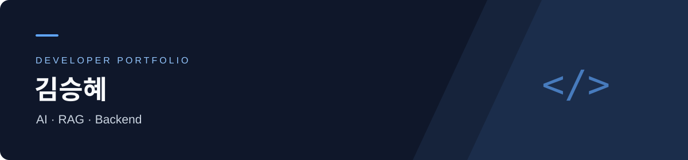

 

### 안녕하세요, 김승혜입니다.

AI와 백엔드를 공부하며, 데이터를 서비스로 연결하는 과정을 프로젝트로 익히고 있습니다.  
Agentic RAG의 검색·검증 흐름과 모델 서빙에 관심을 두고 있습니다.

 

## Focus

| AI & Retrieval | Backend & Serving | Engineering |
| :--- | :--- | :--- |
| 근거를 찾아 답하는 RAG | 모델을 API로 연결하는 과정 | 재현 가능한 실험과 검증 |
| LangChain · LangGraph · FAISS | Python · FastAPI | pytest · Ruff · Docker |

 

## Featured Project

### [KV Cache 기술 평가 · Agentic RAG ↗](https://github.com/seunghye3760-afk/skala-rag-design-course)

KV cache 최적화 기술을 **기술 성숙도·시장성·이해관계자·도메인 적합성** 관점에서 평가하는 팀 프로젝트입니다. 논문과 웹 근거를 수집하고, 관점별 평가와 정보 공백을 보고서로 정리합니다.

- **담당 영역** — 기술 선정 방식 설계, 관점별 웹 가드레일 설계, 문서·임베딩·검색 및 그래프 통합
- **핵심 구성** — FAISS + BM25 하이브리드 검색, LangGraph 기반 에이전트 흐름, 규칙 기반 검증
- **진행 상태** — 실행 흐름 검증과 영역별 구현·평가를 진행 중

`Python` `LangGraph` `LangChain` `FAISS` `Pydantic`

 

## Learning & Practice

### [Model Serving · MLOps / AIOps ↗](https://github.com/seunghye3760-afk/model-serving)

FastAPI 모델 서빙부터 MLflow 기반 모델 관리, 드리프트 감지와 재학습 흐름까지 살펴보는 **학습·실습 저장소**입니다. 원본 저장소를 포크하여 학습에 활용하고 있습니다.

`Python` `FastAPI` `MLflow` `Docker`

 

